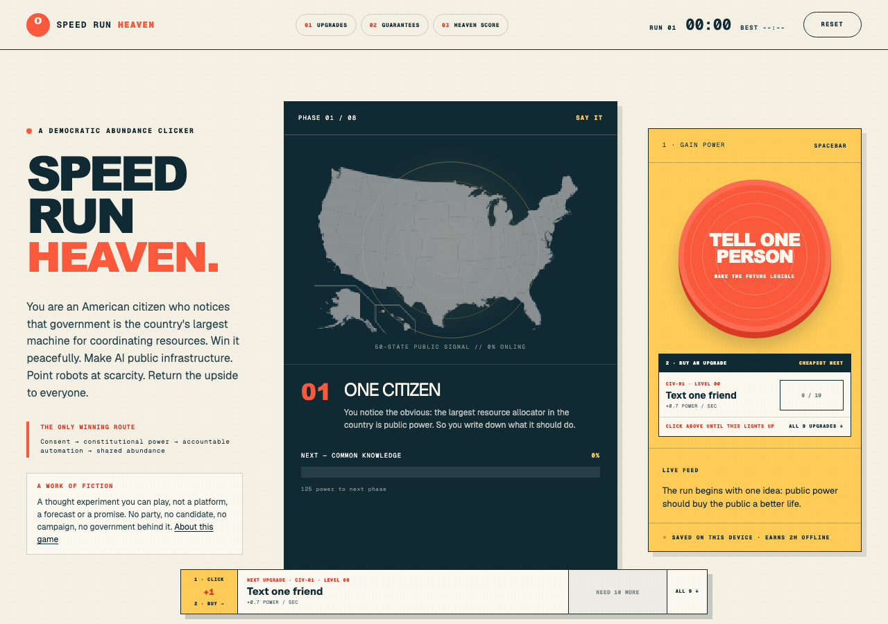

# Speed Run Heaven

**Play:** https://theguysaccount.github.io/speed-run-heaven-civic-game/ · **Guide and speedrun routes:** [/guide/](https://theguysaccount.github.io/speed-run-heaven-civic-game/guide/) · **Screens:** [docs/screens](docs/screens/)

One citizen. One mandate. An automated future that belongs to everyone.

Speed Run Heaven is a free incremental (idle/clicker) browser game, and a work of fiction:
- You start as one citizen making "public power" by hand.
- You build nine compounding civic and automation engines, and enshrine six guarantees that make the system safer and faster.
- You cross eight phases, from *One citizen* to *Heaven is a metric*, against a run clock.
- At the finish you get a share card with your time ("I reached Heaven in 21:30") and a challenge link that shows a friend the time to beat.
- Each finished timeline makes the next one 25% faster.

No account, no ads, no cookies. Saves stay in your browser and earn up to two hours of offline progress. A save code moves a run between devices. It works on phones and computers.



## How it runs (no human in the loop)

| Job | Workflow | When |
|---|---|---|
| Type check, unit tests, build, rendered-HTML tests, scripted playthrough in headless Chrome, deploy to Pages, live check and live playthrough, IndexNow | `pages.yml` | every push that touches the game; by hand; when the self-test finds the live site behind `main` |
| Rendered-HTML tests and scripted playthrough on a fresh build and on the live site, staleness check, alert issue, keep-alive | `selftest.yml` | weekly (Wednesday) |

Each job fails safe: the last good deploy stays live. [OPERATIONS.md](OPERATIONS.md) has the details, what to watch, and the keys that need a human: a custom domain, a support link, analytics and an itch.io release.

## Layout

```
src/engine.ts         all game data and rules, as pure functions (shared by the UI, tests and the scripted player)
src/bot.ts            a scripted player; the guide's route times and the tests use it
src/SpeedRunGame.tsx  the game UI (React), hydrated over server-rendered HTML
src/SharePanel.tsx    the finish-time card, drawn on the player's device, and the challenge link
src/pages.tsx         the guide and about pages, rendered to static HTML at build time
src/styles.css        one stylesheet (the original design, plus release additions)
scripts/build.mjs     esbuild bundle + prerender + sitemap, robots.txt, IndexNow key file, 404 page
scripts/e2e.mjs       scripted playthrough in headless Chrome (local build or live site)
scripts/check-live.mjs, indexnow.mjs, screens.mjs, serve.mjs, keepalive.sh
tests/                unit tests of the rules; rendered-HTML tests of the build
```

## Run, test, deploy

Needs Node 24 (it runs the TypeScript tests directly) and Chrome for the browser tests.

```bash
npm ci --ignore-scripts
npm run build && npm run serve   # http://127.0.0.1:4173/speed-run-heaven-civic-game/
npm test                         # type check, unit tests, build, rendered-HTML tests
npm run e2e                      # scripted playthrough in headless Chrome
npm run screens                  # screenshots into docs/screens/
```

Deploys run from `pages.yml` on every push to `main`. You can also start one with `gh workflow run pages.yml`. Settings are repository variables, listed in [.env.example](.env.example). `SITE_URL` is the single address setting.

## History

The game was built in July 2026 as a vinext (Next.js-compatible) app for ChatGPT Sites / Cloudflare Workers, and never deployed. This repo keeps its game data, rules, copy and design. It renders the same React components to static HTML at build time, so it runs on GitHub Pages. See [STATE.md](STATE.md), [DECISIONS.md](DECISIONS.md), [PRODUCT.md](PRODUCT.md) and [LAUNCH.md](LAUNCH.md).

## Licence

The code and game text are MIT. The share illustration is not covered: all rights are reserved by the project owner. The map outline is CC0, and the fonts are under the OFL. See [LICENSE](LICENSE).
